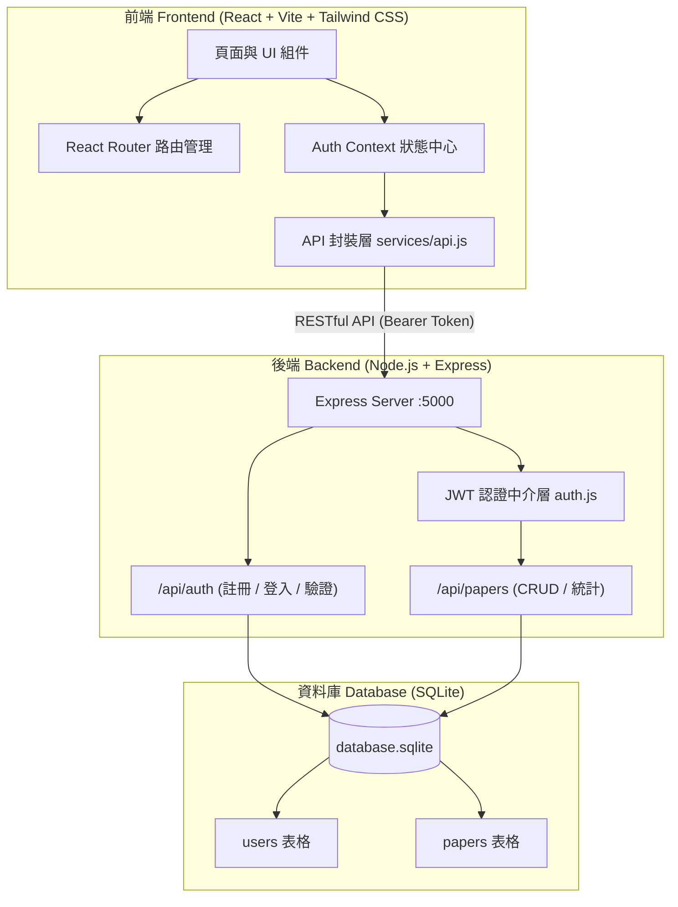

# Research Paper Manager (研究論文管理系統)

[](https://react.dev/)
[](https://vitejs.dev/)
[](https://tailwindcss.com/)
[](https://nodejs.org/)
[](https://expressjs.com/)
[](https://www.sqlite.org/)
[](https://jwt.io/)

> 一個為碩博士研究生與科研學者打造的輕量化文獻閱讀管理系統。支援文獻資料紀錄、閱讀進度追蹤、重要度標記、多維度即時檢索與結構化研究筆記。

---

## 🌟 核心特色 (Core Features)

1. **🔐 身分認證與資料嚴密隔離 (Authentication & Data Isolation)**
   - 採用 `bcryptjs` 密碼加鹽雜湊存儲，保障密碼安全。
   - 基於 JWT (JSON Web Token) 的身分驗證，登入狀態保存於 `localStorage`。
   - 嚴格的資料擁有權機制（SQL 層層綁定 `user_id`），每位研究員僅能讀取與管理自己的文獻。

2. **📊 現代學術儀表板 (Academic Dashboard)**
   - 4 大關鍵進度統計卡片：**總收錄論文 (Total Papers)**、**閱讀中 (Reading)**、**已完成 (Completed)**、**重要文獻 (Important - High Priority)**。
   - **最新收錄論文 (Recent Papers)**：即時列出最近收錄的 5 篇文獻及其狀態與重要度標籤。

3. **📚 完整文獻生命週期管理 (Full CRUD Paper Management)**
   - **新增論文 (`/papers/new`)**：支援標題（必填）、作者群、出版年份、研究領域、閱讀狀態、優先級與研究心得筆記。
   - **文獻總覽 (`/papers`)**：清楚的學術表格與卡片佈局，提供快速檢視、編輯與刪除操作入口。
   - **即時全文檢索 (Instant Search)**：無需請求後端，前端即時比對論文標題與作者姓名。
   - **多條件聯動篩選 (Multi-dimensional Filter)**：可同時針對領域分類、閱讀狀態、重要度進行複合篩選，並能與關鍵字搜尋無縫結合。
   - **文獻詳細資訊 (`/papers/:id`)**：完整展示元數據、作者、年份與清晰排版的研究筆記（Research Notes）。
   - **文獻編輯 (`/papers/:id/edit`)**：表單預載既有內容，隨時補充分析與心得。
   - **防呆刪除機制 (Confirm Modal)**：刪除前跳出確認對話方塊，杜絕誤觸刪除重要文獻。

4. **🇹🇼 繁體中文在地化介面 (Traditional Chinese UI)**
   - 包含導覽列、表單標籤、提示訊息、狀態徽章均以繁體中文專業呈現。
   - 登入頁提供「**一鍵填入展示帳號**」快捷按鈕，方便隨時評測與展示。

---

## 🏗️ 系統架構 (System Architecture)



---

## 📁 專案目錄結構 (Project Structure)

```
research-paper-manager/
├── backend/
│   ├── database/
│   │   ├── database.sqlite     # SQLite 資料庫檔案
│   │   ├── db.js               # 資料庫連線與 Table 初始化
│   │   └── seed.js             # 內建展示帳號與預設文獻腳本
│   ├── middleware/
│   │   └── auth.js             # JWT 權限驗證中介軟體
│   ├── routes/
│   │   ├── auth.js             # 認證路由 (Register, Login, Me)
│   │   └── papers.js           # 論文 CRUD 與統計路由
│   ├── package.json
│   ├── server.js               # 後端伺服器進入點 (:5000)
│   └── test_backend.js         # 後端獨立 API 自動化測試
├── frontend/
│   ├── src/
│   │   ├── components/
│   │   │   ├── Badges.jsx      # 分類、狀態、重要度標籤組件
│   │   │   ├── ConfirmModal.jsx# 刪除防呆確認對話框
│   │   │   ├── Navbar.jsx      # 頂部導覽列 (含登出與使用者資訊)
│   │   │   ├── ProtectedRoute.jsx # 路由防護守門員
│   │   │   └── StatCard.jsx    # 儀表板數據卡片組件
│   │   ├── context/
│   │   │   └── AuthContext.jsx # 登入與 Token 狀態提供者
│   │   ├── pages/
│   │   │   ├── Dashboard.jsx   # 研究儀表板
│   │   │   ├── Login.jsx       # 會員登入 (含一鍵填入 Demo)
│   │   │   ├── PaperDetail.jsx # 論文詳細資訊
│   │   │   ├── PaperForm.jsx   # 論文新增與編輯表單
│   │   │   ├── PaperList.jsx   # 論文列表 (含搜尋與多維度篩選)
│   │   │   └── Register.jsx    # 會員註冊
│   │   ├── services/
│   │   │   └── api.js          # 前端統一 API 請求封裝
│   │   ├── App.jsx             # 路由配置與佈局
│   │   ├── index.css           # 全域樣式與 Tailwind 配置
│   │   └── main.jsx            # React 進入點
│   ├── index.html              # HTML 骨架
│   ├── package.json
│   ├── postcss.config.js
│   ├── tailwind.config.js      # Tailwind CSS 學術風格配色
│   └── vite.config.js          # Vite 配置 (含 /api 反向代理)
├── test_e2e_flow.js            # 42 項全方位端到端自動化驗證測試套件
├── .gitignore                  # Git 排除設定
└── README.md                   # 專案說明與操作指南
```

---

## 🚀 快速開始與使用說明 (Quick Start)

### 1. 環境需求
- **Node.js**: v18.0.0 以上（推薦使用 Node.js 24 LTS）
- **npm**: v9.0.0 以上

---

### 2. 下載專案與安裝依賴

```bash
# Clone 專案至本機
git clone https://github.com/Joeysssss/research-paper-manager.git
cd research-paper-manager

# 安裝後端相依套件
cd backend
npm install

# 安裝前端相依套件
cd ../frontend
npm install
```

---

### 3. 啟動後端伺服器 (Backend)

在 `backend` 目錄下執行：
```bash
node server.js
```
後端將於 **`http://localhost:5000`** 啟動。首次啟動會自動建立 SQLite 資料庫表格並載入測試帳號與種子論文。

---

### 4. 啟動前端開發伺服器 (Frontend)

開啟另一個終端機視窗，進入 `frontend` 目錄並執行：
```bash
npm run dev
```
前端開發伺服器將於 **`http://localhost:5173`** 啟動。

---

### 5. 開啟瀏覽器開始使用

在瀏覽器網址列輸入：
👉 **http://localhost:5173**

#### 🔑 預設測試帳號 (Demo Account)
- **電子郵件 (Email)**: `demo@example.com`
- **密碼 (Password)**: `demo123`
*(登入頁面上方設有「**點擊自動填入展示帳號**」快捷鍵，點選即可秒速填入並登入)*

#### 📖 系統預載種子文獻 (Seed Papers)
1. **Attention Is All You Need** (Vaswani et al., 2017)
   - 領域：`自然語言處理 (NLP)` ｜ 狀態：`已完成` ｜ 重要度：`高重要度`
2. **A Unified Approach to Interpreting Model Predictions** (Lundberg & Lee, 2017)
   - 領域：`可解釋性 AI (XAI)` ｜ 狀態：`閱讀中` ｜ 重要度：`高重要度`
3. **Grad-CAM: Visual Explanations from Deep Networks** (Selvaraju et al., 2017)
   - 領域：`可解釋性 AI (XAI)` ｜ 狀態：`待閱讀` ｜ 重要度：`中等`

---

## 🧪 自動化測試 (Automated Testing)

專案附帶完整的端到端（E2E）自動化驗證測試套件，涵蓋身分驗證、CRUD、即時搜尋、複合篩選、權限防護與跨用戶資料隔離。

確保前後端伺服器運作後，於專案根目錄執行：
```bash
node test_e2e_flow.js
```

### 測試執行成果（42 項測試全數通過）：
```
====================================================
  STARTING COMPREHENSIVE E2E VERIFICATION SUITE     
====================================================

--- Step 1: Backend Health Check ---
[PASS] API health endpoint responds with 200 and status: ok

--- Step 2: Login Flow with Demo Account ---
[PASS] Login returned HTTP 200
[PASS] Login returned valid JWT token
[PASS] User object returned matches demo account

--- Step 3: Error Handling on Invalid Credentials ---
[PASS] Bad password correctly rejected with 401
[PASS] Correct error message returned

--- Step 4: Dashboard Statistics ---
[PASS] Stats endpoint returns HTTP 200
[PASS] Total papers count is >= 3 (actual: 3)
[PASS] Reading count is >= 1 (actual: 1)
[PASS] Completed count is >= 1 (actual: 1)
[PASS] Important count is >= 1 (actual: 2)
[PASS] Recent papers is an array of max 5 items

--- Step 5: Paper List Retrieval ---
[PASS] Paper list returns HTTP 200
[PASS] Retrieved 3 papers
[PASS] Seed paper "Attention Is All You Need" present
[PASS] Seed paper "A Unified Approach..." present
[PASS] Seed paper "Grad-CAM..." present

--- Step 6: Add Paper Flow ---
[PASS] Create paper returns HTTP 201 Created
[PASS] Created paper title matches payload
[PASS] Generated paper ID is valid (6)
[PASS] Missing title correctly rejected with HTTP 400

--- Step 7: Paper Detail Flow ---
[PASS] Paper detail returns HTTP 200
[PASS] Detail title matches
[PASS] Detail notes match
[PASS] Detail category matches

--- Step 8: Edit Paper Flow ---
[PASS] Update paper returns HTTP 200
[PASS] Updated title persisted
[PASS] Updated status is "Reading"

--- Step 9: Search and Filter Verification ---
[PASS] Search by Author "Vaswani" matches 1 paper
[PASS] Category "Explainable AI" matches 2 papers (actual: 2)
[PASS] Status "Reading" matches expected papers (actual: 2)
[PASS] Combined Search + Filter correctly isolates target paper

--- Step 10: Delete Paper Flow ---
[PASS] Delete paper returns HTTP 200
[PASS] Delete success message confirmed
[PASS] Deleted paper cannot be fetched (HTTP 404)

--- Step 11: Register Flow & Cross-User Security Isolation ---
[PASS] User registration returns HTTP 201
[PASS] User registration generated user ID
[PASS] Duplicate email registration correctly rejected with HTTP 400
[PASS] New user logged in successfully and received JWT
[PASS] New user sees 0 papers (Isolated from Demo user)
[PASS] User cannot access another user's paper (Returns 404 Not Found)

--- Step 12: Unauthenticated Request Guard ---
[PASS] Unauthenticated request correctly rejected with HTTP 401

====================================================
  E2E TEST SUMMARY: 42 PASSED, 0 FAILED 
====================================================
```

---

## 📡 RESTful API 規格表 (API Endpoints)

所有 `/api/papers` 端點均受到 JWT 保護，請求標頭需帶入：
`Authorization: Bearer <TOKEN>`

| HTTP 方法 | 端點 (Endpoint) | 權限要求 | 說明 |
| :--- | :--- | :---: | :--- |
| `POST` | `/api/auth/register` | 公開 | 註冊新帳號 (`name`, `email`, `password`) |
| `POST` | `/api/auth/login` | 公開 | 登入並取得 JWT Token |
| `GET` | `/api/auth/me` | 需要 JWT | 取得當前登入者資訊 |
| `GET` | `/api/papers/stats` | 需要 JWT | 取得儀表板 4 大指標與最近收錄論文 |
| `GET` | `/api/papers` | 需要 JWT | 取得該使用者名下所有論文 |
| `GET` | `/api/papers/:id` | 需要 JWT | 取得指定論文的完整詳細資料與筆記 |
| `POST` | `/api/papers` | 需要 JWT | 新增論文 |
| `PUT` | `/api/papers/:id` | 需要 JWT | 編輯並更新論文資訊 |
| `DELETE` | `/api/papers/:id` | 需要 JWT | 刪除指定論文 |

---

## 🗄️ 資料庫結構 (Database Schema)

### `users` 資料表
```sql
CREATE TABLE IF NOT EXISTS users (
  id INTEGER PRIMARY KEY AUTOINCREMENT,
  name TEXT NOT NULL,
  email TEXT UNIQUE NOT NULL,
  password TEXT NOT NULL,
  created_at DATETIME DEFAULT CURRENT_TIMESTAMP
);
```

### `papers` 資料表
```sql
CREATE TABLE IF NOT EXISTS papers (
  id INTEGER PRIMARY KEY AUTOINCREMENT,
  user_id INTEGER NOT NULL,
  title TEXT NOT NULL,
  authors TEXT,
  year INTEGER,
  category TEXT,
  status TEXT DEFAULT 'To Read',
  priority TEXT DEFAULT 'Medium',
  notes TEXT,
  created_at DATETIME DEFAULT CURRENT_TIMESTAMP,
  FOREIGN KEY (user_id) REFERENCES users(id) ON DELETE CASCADE
);
```

---

## 💡 如何推送到自己的 GitHub 倉庫 (Push to GitHub)

如果您想要將本專案上傳至個人 GitHub，請依照以下步驟：

1. **在 GitHub 建立一個新的空白 Repository**（例如命名為 `research-paper-manager`，不要勾選初始化 README）。
2. 在本機終端機進入專案目錄，執行以下指令：

```bash
cd research-paper-manager

# 初始化本地 Git 儲存庫
git init

# 將所有專案檔案加入暫存區
git add .

# 建立首次提交
git commit -m "feat: initial commit for Research Paper Manager"

# 設定主分支名稱為 main
git branch -M main

# 關聯至您的 GitHub Repository (請替換為您的倉庫網址)
git remote add origin https://github.com/<YOUR_USERNAME>/research-paper-manager.git

# 推送至 GitHub
git push -u origin main
```

---

## 📄 License
本專案為教學展示用途，遵循 MIT 授權規範。
